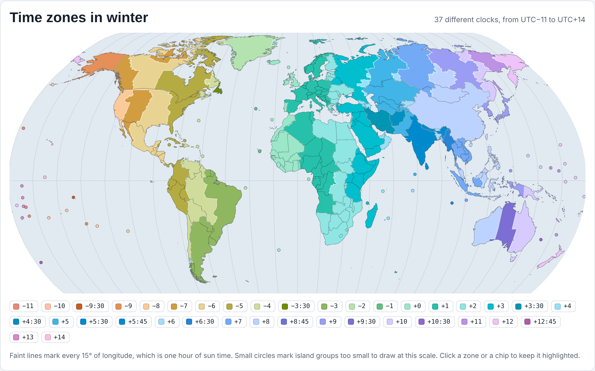
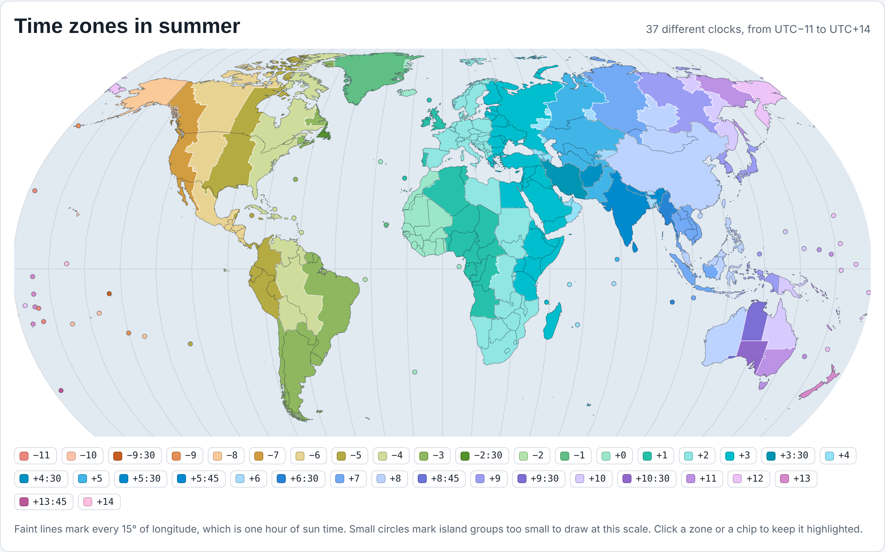

# Winter and Summer Time Zones

An interactive world map showing which clock every country and region keeps, in **winter** (standard time) and in **summer** (daylight saving time), with every time zone ranked by the number of people living on it.

**Live page:** https://YOUR-USERNAME.github.io/YOUR-REPOSITORY/

| Winter | Summer |
|---|---|
|  |  |

Made with **Claude** (Anthropic): the data collection, population calculations, map processing and page design were done by Claude, at my request.

## What it shows

- Places with the same colour share the same clock.
- Use the Winter / Summer switch to compare the two seasons. Hover over or tap a zone to see its population, its share of the world and which countries share that clock.
- Each place is shown in its own season. North of the equator, summer is roughly March to October. In Australia, New Zealand and Chile it is roughly October to April.
- About 1.17 billion people (14% of the world) change their clocks between winter and summer.

### Most populous time zones

| Rank | Winter | People | Summer | People |
|---|---|---|---|---|
| 1 | UTC+8 | 1,653 M | UTC+8 | 1,653 M |
| 2 | UTC+5:30 | 1,486 M | UTC+5:30 | 1,486 M |
| 3 | UTC+1 | 905 M | UTC+3 | 959 M |
| 4 | UTC+3 | 729 M | UTC+2 | 751 M |
| 5 | UTC+2 | 568 M | UTC+1 | 581 M |
| 6 | UTC+7 | 442 M | UTC+7 | 442 M |
| 7 | UTC+5 | 353 M | UTC+5 | 353 M |
| 8 | UTC−5 | 327 M | UTC−4 | 283 M |

## How it was made

- **Clock rules:** IANA tz database 2026e, using the 2027 rules. Winter = the earlier of a place's January and July offsets; summer = the later. This includes recent changes: British Columbia, Alberta and Manitoba keep daylight time all year from 1 November 2026, and Morocco moved to permanent UTC+0 on 20 September 2026.
- **Population:** World Bank estimates for 2025. Countries that span several zones (United States, Russia, Brazil, Mexico, Indonesia, Canada, Australia, DR Congo) are split by state or province populations. Small splits (parts of US states, Mexican border towns, outlying islands) use rounded figures, so the smallest zones are approximate.
- **Choices:** China is shown on UTC+8 nationwide. Crimea is drawn on UTC+3, as the tz database records it. Antarctica is left off.

## Data sources and credits

- Time zone boundaries: [timezone-boundary-builder](https://github.com/evansiroky/timezone-boundary-builder) release 2026e, © OpenStreetMap contributors, available under the [Open Database License (ODbL)](https://opendatacommons.org/licenses/odbl/).
- Time zone rules: [IANA tz database](https://www.iana.org/time-zones) (public domain).
- Coastlines and country borders: [Natural Earth](https://www.naturalearthdata.com/) (public domain).
- Country populations: [World Bank, SP.POP.TOTL](https://data.worldbank.org/indicator/SP.POP.TOTL) (CC BY 4.0).
- Regional populations: US Census Bureau (2025 estimates), Rosstat (2025), IBGE 2022 census, INEGI 2020 census, Statistics Indonesia 2020 census, Statistics Canada 2021 census, Australian Bureau of Statistics (March 2026), DR Congo 2019 provincial estimates; Taiwan household register (June 2026).

## Viewing it on your own computer

Download `index.html` and open it in any web browser. It needs no installation. The fonts load from Google Fonts when you are online; offline it falls back to your system fonts.
